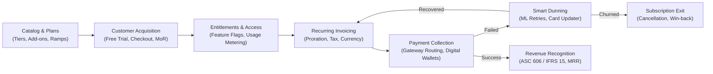

# 🔄 Awesome Subscription Lifecycle Management

  
  
  
  
  
  

  <strong>A curated directory of top Subscription Lifecycle Management platforms — featuring SaaS solutions, developer-first usage metering engines, and self-hosted open-source recurring billing stacks.</strong>

  Master the subscription lifecycle: Automated Catalog Management • Proration • Smart Dunning &amp; Involuntary Churn Recovery • Usage Metering • Multi-Currency Invoicing • ASC 606 Revenue Recognition • Merchant of Record (MoR)

---

## 📑 Table of Contents

- [🌐 Sector Overview &amp; Market Dynamics](#-sector-overview--market-dynamics)
- [☁️ Commercial SaaS Platforms](#️-commercial-saas-platforms)
  - [📊 SaaS Platforms Comparison Table](#-saas-platforms-comparison-table)
  - [🏢 Deep-Dive into SaaS Providers](#-deep-dive-into-saas-providers)
- [🔓 Open-Source Software](#-open-source-software)
  - [⭐ Open-Source Leaderboard](#-open-source-leaderboard)
  - [🛠️ Deep-Dive into Open-Source Solutions](#️-deep-dive-into-open-source-solutions)
- [🧩 Subscription Lifecycle Architecture &amp; Key Concepts](#-subscription-lifecycle-architecture--key-concepts)
- [🤝 Contributing](#-contributing)
- [💖 Support &amp; Sponsorship](#-support--sponsorship)
- [##  Star History](#--star-history)
- [📄 License](#-license)

---

## 🌐 Sector Overview & Market Dynamics

The global subscription and billing management software market is valued at approximately **$8.8 billion to $10.0 billion in 2025–2026**, expanding rapidly at a compound annual growth rate (CAGR) of 14–17% toward an estimated $20+ billion by the early 2030s. The sector is **moderately fragmented**—while underlying raw payment processing infrastructure leans heavily toward consolidated financial rails like Stripe and Adyen, the subscription orchestration layer remains diversified between enterprise CPQ/RevRec suites (Zuora, Maxio), developer-first usage-based engines (Orb, Metronome), Merchant-of-Record aggregators (Paddle), and self-hosted open-source engines (Lago, Kill Bill, OpenMeter), rather than a single winner-take-all monopoly.

### Key Drivers Accelerating Market Growth:
- 📈 **Hybrid & Consumption Monetization:** SaaS businesses are transitioning from pure flat-rate recurring tiers to hybrid subscriptions blended with real-time usage-based metering (API calls, AI compute tokens, seat overages).
- 🛡️ **Intelligent Involuntary Churn Mitigation:** Algorithmic smart retries, network tokenization, and dynamic dunning workflows recover 30–50% of delinquent payments that would otherwise convert into involuntary customer churn.
- 🌍 **Global Tax & Compliance Complexity:** Emerging local sales tax, VAT/GST cross-border rules, and ASC 606 / IFRS 15 automated revenue recognition make dedicated lifecycle billing tools non-negotiable for scaling companies.

---

## ☁️ Commercial SaaS Platforms

### 📊 SaaS Platforms Comparison Table

The table below lists leading commercial SaaS subscription lifecycle platforms, sorted descending by **Company Scale / Valuation**:

| 🏢 Platform | 💰 Company Scale / Valuation | 🏷️ Starting Pricing (Live Tiers) | 🎁 Free Tier / Free Trial Limits | ⚙️ Architecture &amp; Model | 💳 Payment Processing |
| :--- | :--- | :--- | :--- | :--- | :--- |
| **[Stripe Billing](https://stripe.com/billing)** | **~$70 Billion Valuation** ($4B+ net revenue / $14B+ gross) | **0.7% per recurring transaction** (Scale tier at 0.8% + standard Stripe card processing 2.9% + $0.30) | **Unlimited developer test sandbox** with synthetic cards and webhooks (no live free transaction volume) | Integrated billing layer on top of Stripe payment rails | Native Stripe processing |
| **[Chargebee](https://www.chargebee.com/)** | **~$3.5 Billion Valuation** ($150M+ ARR) | **$0/mo on Starter tier**; scales to **$599/mo** on Performance tier (includes $25k/mo billing + 0.75% overage) | **Starter Plan free forever up to $250,000 in lifetime billing volume**; includes unlimited sandbox testing | Deep subscription lifecycle engine with CPQ, proration, and usage add-ons | Gateway agnostic (40+ gateways supported) |
| **[Zuora](https://www.zuora.com/)** | **~$1.7 Billion Valuation** (Acquired by Silver Lake &amp; GIC; ~$450M ARR) | **~$1,500/mo ($18,000/yr minimum annual contract)** on Growth tier | **30-day guided interactive sandbox test drive** upon sales qualification (no live free-forever tier) | Enterprise monetization suite with CPQ, billing, and RevPro (ASC 606) revenue recognition | Multi-gateway enterprise orchestration |
| **[Paddle](https://www.paddle.com/)** | **~$1.4 Billion Valuation** ($100M+ ARR) | **5% + $0.50 per successful checkout transaction** ($0 monthly recurring software platform fee) | **Indefinite sandbox testing environment**; **$0/mo fixed fee in production** (pay-as-you-transact only) | Merchant of Record (MoR) managing global tax, fraud, localized checkout, and billing | Native reseller/MoR handling all payments |
| **[Metronome](https://metronome.com/)** | **~$1.0 Billion Valuation** (Acquired by Stripe in 2026; raised at $500M+ prior) | **~$3,000/mo minimum annual consumption platform commitment** (+ tiered ingestion per million events) | **14-day dedicated developer sandbox / PoC instance** with custom sales onboarding | High-throughput, real-time consumption and usage-based rating infrastructure | Direct integration with Stripe &amp; enterprise ledgers |
| **[Maxio](https://www.maxio.com/)** | **~$600 Million Valuation** ($75M+ ARR; backed by Battery Ventures) | **$599/mo** (Grow plan, billed annually for up to $100k/mo billing volume) | **Build Plan: indefinite free sandbox environment** for developers to test APIs and recurring logic without live charges | B2B SaaS subscription management, complex contract billing, and SaaS financial analytics | Integrated multi-gateway gateway routing |
| **[Recurly](https://recurly.com/)** | **~$450 Million Valuation** ($90M+ ARR; backed by Accel-KKR) | **$249/mo + 0.9% of billing volume** (Starter plan; includes first $40k/mo billing volume) | **90-day free trial on Starter plan** with full platform feature access and sandbox testing | Subscription lifecycle management with proprietary ML-driven churn recovery | Gateway agnostic (20+ payment gateways) |
| **[Orb](https://withorb.com/)** | **~$250–$300 Million Valuation** (Series B funded) | **~$700/mo baseline platform fee** (Core tier for usage-based metering, invoicing, and SQL metrics) | **Developer sandbox access by demo request** with simulated event streaming; no self-serve live free tier | Developer-first usage-based billing and event ingestion engine | Bring-your-own gateway (syncs with Stripe) |

---

### 🏢 Deep-Dive into SaaS Providers

#### 🔹 [Stripe Billing](https://stripe.com/billing)
* **Primary Focus:** Native recurring billing and invoicing directly integrated into the Stripe financial infrastructure.
* **Key Strengths:** Seamless zero-gateway setup, Smart Retries powered by Stripe's global transaction dataset, hosted customer portal, automated tax calculation via Stripe Tax, and unified balance reporting.
* **Trade-Offs:** You remain the Merchant of Record; complex multi-entity B2B contracts, hybrid ramps, and customized CPQ workflows require significant custom code compared to dedicated subscription engines.

#### 🔹 [Chargebee](https://www.chargebee.com/)
* **Primary Focus:** Advanced subscription lifecycle control, complex contract management, and multi-gateway billing logic.
* **Key Strengths:** Handles almost every billing edge-case out of the box: grandfathered plans, tiered usage add-ons, calendar-based billing dates, gift subscriptions, and native CRM/ERP integrations (Salesforce, NetSuite).
* **Trade-Offs:** Requires separate payment gateway relationships and merchant accounts; costs add up as transaction volume exceeds base tier thresholds.

#### 🔹 [Zuora](https://www.zuora.com/)
* **Primary Focus:** Enterprise recurring monetization, complex quotes, multi-entity subsidiaries, and automated revenue recognition.
* **Key Strengths:** Industry standard for global Fortune 500 enterprises, deep ASC 606 and IFRS 15 compliance automation with Zuora RevPro, enterprise CPQ, and high-volume billing runs across dozens of legal entities.
* **Trade-Offs:** High entry cost ($18k+/yr minimums) and multi-month implementation timelines typically requiring specialized systems integration partners.

#### 🔹 [Paddle](https://www.paddle.com/)
* **Primary Focus:** Merchant of Record (MoR) for SaaS, desktop applications, and digital goods.
* **Key Strengths:** Paddle acts as the legal reseller, meaning they handle sales tax/VAT registration, collection, and remittance across 200+ jurisdictions, chargeback disputes, and global payment compliance automatically.
* **Trade-Offs:** Higher percentage fee (5% + $0.50) compared to raw payment gateways; lower flexibility if you require direct customer merchant accounts or custom banking merchant IDs.

#### 🔹 [Metronome](https://metronome.com/)
* **Primary Focus:** High-throughput consumption and usage-based billing infrastructure for modern API and AI platforms.
* **Key Strengths:** Handles billions of raw telemetry events per day, real-time balance calculations, SQL-based billable metrics, and seamless integration into Stripe's enterprise billing ecosystem.
* **Trade-Offs:** Oriented strictly toward mid-market and enterprise consumption models with sales-led annual commitments.

#### 🔹 [Maxio](https://www.maxio.com/)
* **Primary Focus:** Financial operations, contract-driven B2B SaaS subscription management, and revenue analytics.
* **Key Strengths:** Formed through the combination of SaaSOptics and Chargify; combines operational billing workflows with out-of-the-box SaaS investor metrics (Net Retention Rate, Churn, ARR cohorts, GAAP revenue schedules).
* **Trade-Offs:** Primed specifically for B2B contract motions; less aligned with high-frequency B2C micro-transactions.

#### 🔹 [Recurly](https://recurly.com/)
* **Primary Focus:** Subscription management with industry-leading involuntary churn mitigation and automated dunning.
* **Key Strengths:** Machine learning algorithms continuously determine optimal card retry schedules across various issuing banks, recovering a documented 12% higher revenue yield on delinquent transactions; comprehensive digital wallet support (Apple Pay, Google Pay, Venmo).
* **Trade-Offs:** Less native depth in usage-based telemetry and complex multi-layered CPQ compared to specialized consumption engines.

#### 🔹 [Orb](https://withorb.com/)
* **Primary Focus:** Developer-first usage-based pricing, event stream rating, and prepaid drawdown workflows.
* **Key Strengths:** Flexible schema-free event ingestion, real-time rating and invoicing, pricing experiments, and transparent developer documentation designed for modern engineering teams.
* **Trade-Offs:** Focused primarily on consumption billing; traditional flat-rate subscription management features are secondary.

---

## 🔓 Open-Source Software

Self-hosted, transparent, and extensible open-source subscription and billing engines. These platforms provide full data residency control, zero vendor revenue share, and no artificial plan gating.

### ⭐ Open-Source Leaderboard

Below is the open-source leaderboard sorted descending by **GitHub_Stars**:

| 🛠️ Project | ⭐ GitHub_Stars | 💻 Technology Stack | 📜 License | 🎯 Primary Focus |
| :--- | :--- | :--- | :--- | :--- |
| **[Hyperswitch](https://github.com/juspay/hyperswitch)** |  | Rust / PostgreSQL / Redis | Apache-2.0 | High-performance payment switch, recurring routing &amp; mandate vaulting |
| **[Lago](https://github.com/getlago/lago)** |  | Ruby on Rails / PostgreSQL / Redis / ClickHouse | AGPL-3.0 | Modern usage-based metering, hybrid pricing, and subscription billing engine |
| **[Crater](https://github.com/crater-invoice/crater)** |  | PHP / Laravel / Vue.js / MySQL | AGPL-3.0 | Self-hosted invoicing, recurring billing, and client payment portal |
| **[Kill Bill](https://github.com/killbill/killbill)** |  | Java / MySQL / PostgreSQL / MariaDB | Apache-2.0 | Battle-tested enterprise subscription lifecycle &amp; payment engine since 2010 |
| **[OpenMeter](https://github.com/openmeterio/openmeter)** |  | Go / ClickHouse / Kafka / PostgreSQL | Apache-2.0 | Real-time cloud-native usage metering and consumption billing for AI &amp; APIs |
| **[Tier](https://github.com/tierrun/tier)** |  | Go / Stripe SDK | Apache-2.0 | Developer-first pricing SDK and model engine powered by Stripe |
| **[Servicebot](https://github.com/service-bot/servicebot)** |  | JavaScript / Node.js / React / MongoDB | GPL-3.0 | Open-source subscription management and self-serve onboarding portal |
| **[UniBee](https://github.com/UniBee-Billing/unibee)** |  | Go / Vue.js / MySQL | Apache-2.0 | Self-hosted SaaS recurring billing, checkout portal &amp; license key engine |
| **[Reorder](https://github.com/reorder-js/reorder)** |  | TypeScript / Medusa Framework | MIT | Native headless subscription plugin with dunning retries for Medusa.js |
| **[Zentla](https://github.com/hexrift/zentla)** |  | TypeScript / Node.js / PostgreSQL | Apache-2.0 | Vendor-agnostic monetization layer, entitlements &amp; multi-provider billing |

---

### 🛠️ Deep-Dive into Open-Source Solutions

#### 1. [Hyperswitch](https://github.com/juspay/hyperswitch) 
* **Stack:** Rust / PostgreSQL / Redis | **License:** Apache-2.0
* **Overview:** Developed by Juspay, Hyperswitch is an ultra-fast payment orchestration switch that manages card vaulting, multi-processor smart routing, automated recurring payment mandates, and subscription failover.
* **Key Features:** Single API across 50+ payment processors, customer payment method tokenization, unified dunning retries, zero vendor lock-in, and sub-second payment routing latencies.
* **Best For:** High-volume platforms needing full ownership over recurring transaction routing and multi-gateway redundancy.

#### 2. [Lago](https://github.com/getlago/lago) 
* **Stack:** Ruby on Rails / PostgreSQL / Redis / ClickHouse | **License:** AGPL-3.0
* **Overview:** The premier open-source metering and billing engine built as an alternative to Chargebee and Stripe Billing. Lago decouples usage calculation from payment execution.
* **Key Features:** Event-based consumption metering, prepaid wallet credits, hybrid recurring + metered pricing, coupon &amp; discount management, automatic invoice PDF generation, and webhook triggers to sync with Stripe, Adyen, and GoCardless.
* **Best For:** Modern SaaS, AI, and developer tools teams wanting an open, scalable consumption-billing stack without paying a percentage of their GMV.

#### 3. [Crater](https://github.com/crater-invoice/crater) 
* **Stack:** PHP / Laravel / Vue.js / MySQL | **License:** AGPL-3.0
* **Overview:** A beautifully designed web and mobile invoicing and recurring billing suite crafted for freelancers, agencies, and small service companies.
* **Key Features:** Automated recurring invoices, payment gateway support (Stripe, PayPal, Razorpay), multi-currency estimates, tax calculations, customer self-serve portals, and dedicated iOS &amp; Android companion apps.
* **Best For:** Freelancers and digital agencies requiring a turnkey, self-hosted recurring invoicing tool with a clean UI.

#### 4. [Kill Bill](https://github.com/killbill/killbill) 
* **Stack:** Java / MySQL / PostgreSQL / MariaDB | **License:** Apache-2.0
* **Overview:** The most established and battle-tested open-source subscription and billing engine in the world, in continuous active production since 2010 under the permissive Apache-2.0 license.
* **Key Features:** Complete subscription lifecycle management: multi-phase pricing (trials, introductory discounts, evergreen renewals), complex catalog definitions, proration calculations, invoice generation, overdue dunning state machines, and modular OSGI plugins for Stripe, Adyen, Braintree, Avalara, and Vertex.
* **Best For:** Mid-market and enterprise engineering teams committed to owning their billing infrastructure with strict regulatory or on-premise data residency mandates.

#### 5. [OpenMeter](https://github.com/openmeterio/openmeter) 
* **Stack:** Go / ClickHouse / Apache Kafka / PostgreSQL | **License:** Apache-2.0
* **Overview:** A high-throughput, cloud-native usage metering platform that collects, aggregates, and attributes product consumption events with sub-second latency.
* **Key Features:** Kafka-backed event streaming, ClickHouse OLAP aggregation for billions of events, real-time entitlement gating, balance tracking, and bidirectional connectors for Stripe Billing and Lago.
* **Best For:** AI and cloud infrastructure products that charge by tokens, compute seconds, or network bandwidth and need real-time customer balances.

#### 6. [Tier](https://github.com/tierrun/tier) 
* **Stack:** Go / Stripe SDK | **License:** Apache-2.0
* **Overview:** An open-source pricing engine and developer SDK that defines SaaS pricing models via declarative JSON (`pricing.json`) and runs seamlessly on top of Stripe.
* **Key Features:** Unified API for feature gating (`tier.can()`), meter reporting (`tier.report()`), and checkout session creation; eliminates billing boilerplate code in application layers.
* **Best For:** Software engineers standardizing on Stripe who want clean, code-first feature access control and pricing plan definitions.

#### 7. [Servicebot](https://github.com/service-bot/servicebot) 
* **Stack:** JavaScript / Node.js / React / MongoDB | **License:** GPL-3.0
* **Overview:** An open-source subscription management and billing automation application that wraps Stripe Elements and Stripe Billing into a ready-to-deploy customer portal.
* **Key Features:** Embeddable pricing tables, self-service customer billing portals (upgrade, downgrade, cancel, update payment method), and configurable webhook notifications.
* **Best For:** Rapid prototyping and bootstrapped indie developers seeking a quick drop-in customer billing portal for Stripe.

#### 8. [UniBee](https://github.com/UniBee-Billing/unibee) 
* **Stack:** Go / Vue.js / MySQL | **License:** Apache-2.0
* **Overview:** A self-hosted subscription billing and client management system created specifically for independent software vendors and digital product developers.
* **Key Features:** Automated recurring invoicing, self-serve subscriber portal, coupon management, license key generation, multi-tier pricing, and automated VAT/tax breakdowns.
* **Best For:** Software vendors selling downloadable desktop applications or self-hosted license keys with subscription renewals.

#### 9. [Reorder (Medusa)](https://github.com/reorder-js/reorder) 
* **Stack:** TypeScript / Medusa Commerce Framework | **License:** MIT
* **Overview:** An MIT-licensed native subscription plugin tailored for the Medusa headless e-commerce ecosystem, eliminating third-party recurring billing SaaS fees.
* **Key Features:** Full subscription lifecycle state machine (create, pause, resume, skip order, cancel), configurable dunning intervals with smart retries, admin UI extensions, and customer storefront endpoints.
* **Best For:** Direct-to-consumer (D2C) brands, physical subscription boxes, and e-commerce stores running on Medusa 2.0+.

#### 10. [Zentla](https://github.com/hexrift/zentla) 
* **Stack:** TypeScript / Node.js / PostgreSQL | **License:** Apache-2.0
* **Overview:** A modern, vendor-agnostic monetization and entitlements layer that allows companies to decouple product features and plan access from the underlying payment processor.
* **Key Features:** Multi-provider billing abstraction (Stripe, Zuora, Adyen), real-time feature gating, unified revenue analytics, and automated plan migration tooling.
* **Best For:** Engineering teams looking to avoid payment provider lock-in and run dynamic pricing experiments across multiple regions.

---

## 🧩 Subscription Lifecycle Architecture & Key Concepts

A complete Subscription Lifecycle Management (SLM) platform orchestrates several mission-critical revenue operations:

### 🗝️ Core Functional Pillars:
1. **Catalog & Plan Configuration:** Managing multi-phase plans (trial periods, discounted introductory rates, grandfathered pricing, seat increments, and bundles).
2. **Usage Telemetry & Rating:** Ingesting high-cardinality consumption data (API calls, GB stored, active seats) and applying tiered, volume, or peak algorithms to generate billable units.
3. **Proration & Plan Transitions:** Automatically calculating instant credits and debit adjustments when customers upgrade or downgrade midway through a billing cycle.
4. **Smart Dunning & Involuntary Churn Recovery:** Orchestrating automated retry schedules, credit card account updaters, and multi-channel customer notifications to cure expired or declined payment methods.
5. **Merchant of Record (MoR) vs. Gateway:** Understanding the operational distinction between billing software that requires your own merchant accounts (Stripe, Chargebee, Lago) versus full-service legal resellers (Paddle) that assume liability for global tax filing.

---

## 🤝 Contributing

Contributions are warmly welcomed! If you would like to submit a new open-source project or suggest updates to existing platform data, please follow these steps:

1. 🍴 Fork the repository.
2. 🌿 Create your feature branch (`git checkout -b feature/add-new-billing-tool`).
3. 📝 Add your entry with accurate metadata (project URL, stack, license, GitHub_Stars, and key differentiator).
4. 🚀 Commit your changes (`git commit -m "Add New-Billing-Tool to open-source directory"`).
5. 📬 Open a pull request against the `main` branch.

Please ensure open-source submissions are genuinely open-source (permissive or copyleft license) and actively maintained.

---

## 💖 Support & Sponsorship

Thank you so much for exploring and using **Awesome Subscription Lifecycle Management**!

Curating, researching, and keeping this directory continuously up to date with verified SaaS pricing tiers, open-source projects, and subscription architecture best practices requires dedicated effort. If this repository has helped you or your engineering/finance team make better billing infrastructure decisions, please consider supporting the project:

- ⭐ **Star this repository** to boost visibility and help others discover it.
- 🍴 **Fork and share** the repo with your developer community and colleagues.
- 📢 **Spread the word** on Twitter/X, LinkedIn, Reddit, or developer forums.
- ☕ **Buy me a coffee / Sponsor on GitHub:** You can sponsor ongoing maintenance and research directly via the [GitHub Sponsor Dashboard](https://github.com/sponsors/ishandutta2007).

  
  

---

##  Star History

---

## 📄 License

This list is released under the [CC0 1.0 Universal (Public Domain)](https://creativecommons.org/publicdomain/zero/1.0/) license. Individual products, trademarks, and open-source software libraries listed retain their respective licenses and rights.

---

  <strong>🌟 Star this repository if you find it helpful for your billing architecture decisions! 🌟</strong>

